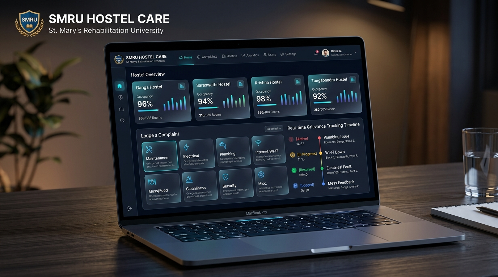

# 🏨 SMRU Hostel Care

**Centralized Hostel Complaint & Resolution Platform**

A modern, full-stack web application for managing hostel complaints with real-time tracking, automated department routing, and role-based access control.



## ✨ Features

### 🎯 **Core Functionality**
- **Student Portal**: Submit, track, and manage complaints
- **Staff Dashboard**: Department-wise complaint management
- **Real-time Updates**: Live status tracking across devices
- **Automated Routing**: Smart department assignment based on complaint category
- **Role-Based Access**: Student, Staff, Warden, and Admin roles

### 🎨 **Modern UI/UX**
- **Dual Theme Support**: Professional dark and light themes
- **Glassmorphism Design**: Modern visual effects with ambient orbs
- **Mobile Responsive**: Perfect experience on all devices
- **Smooth Animations**: Engaging user interactions

### 🔧 **Technical Features**
- **Full-Stack Architecture**: Frontend + Supabase backend
- **Offline Support**: Works offline, syncs when back online
- **Real-time Sync**: WebSocket-based live updates
- **Secure Authentication**: JWT-based user management
- **Data Validation**: Comprehensive form validation and error handling

## 🚀 Quick Start

### Prerequisites
- Modern web browser (Chrome, Firefox, Safari, Edge)
- [Supabase account](https://supabase.com) (free tier available)

### 1. Clone the Repository
```bash
git clone https://github.com/your-username/smru-hostel-care.git
cd smru-hostel-care
```

### 2. Setup Supabase Backend
1. Create a new project at [supabase.com](https://supabase.com)
2. Run the SQL schema from `supabase_schema.sql` in your Supabase SQL editor
3. Get your Project URL and API key from Settings > API
4. Update `supabase-config.js` with your credentials:
```javascript
const SUPABASE_URL = 'https://your-project-ref.supabase.co';
const SUPABASE_ANON_KEY = 'your-anon-key-here';
```

### 3. Launch the Application
Simply open `index.html` in your web browser or use a local server:
```bash
# Using Python
python -m http.server 3000

# Using Node.js
npx serve .

# Using PHP
php -S localhost:3000
```

## 📱 Usage

### For Students
1. **Register**: Create your student account with hostel details
2. **Login**: Access your personal dashboard
3. **Submit Complaints**: Choose category, describe issue, attach photos
4. **Track Progress**: Monitor complaint status in real-time
5. **Provide Feedback**: Rate resolution quality

### For Staff
1. **Login**: Use your official institutional email
2. **View Assignments**: See complaints assigned to your department
3. **Update Status**: Mark complaints as acknowledged, in-progress, or resolved
4. **Add Comments**: Communicate with students and colleagues
5. **Generate Reports**: Export complaint analytics

## 🏗️ Project Structure

```
smru-hostel-care/
├── index.html              # Main application file
├── app.js                  # Core application logic
├── style.css               # Styling and themes
├── supabase-config.js      # Backend configuration
├── supabase_schema.sql     # Database schema
├── assets/
│   ├── smru_logo.png       # Institution logo
│   └── preview_images/     # App screenshots
├── README.md               # This file
├── SUPABASE_SETUP.md       # Detailed setup guide
└── .gitignore              # Git ignore rules
```

## 🎯 Complaint Categories

The system handles 10 major complaint categories:

1. **Cupboard & Locker Problems** → Maintenance
2. **Water Problems** → Maintenance  
3. **Bathroom Problems** → Sanitation
4. **Room Issues** → Maintenance
5. **Food & Mess Problems** → Mess Manager
6. **Dhobi & Laundry Problems** → Dhobi Manager
7. **Internet & WiFi Problems** → IT Department
8. **Common Area Issues** → General Maintenance
9. **Security Concerns** → Warden
10. **Other Issues** → General Administration

## 🔒 Security Features

- **Row Level Security (RLS)** on all database tables
- **JWT Authentication** with secure session management
- **Role-based permissions** for data access
- **Input validation** and XSS protection
- **HTTPS enforcement** in production
- **Audit logging** for all critical operations

## 📊 Database Schema

### Key Tables
- `profiles` - User profiles (students, staff, admins)
- `complaints` - Complaint records with full lifecycle tracking
- `complaint_status_history` - Timeline of status changes
- `notifications` - In-app notification system
- `announcements` - System-wide announcements
- `departments` - Organizational structure
- `audit_logs` - Security audit trail

## 🌟 Technical Highlights

### Frontend
- **Vanilla JavaScript** - No framework dependencies
- **CSS Grid & Flexbox** - Modern responsive layouts
- **Web APIs** - File uploads, notifications, local storage
- **Progressive Enhancement** - Works without JavaScript

### Backend (Supabase)
- **PostgreSQL** - Robust relational database
- **Real-time subscriptions** - WebSocket connections
- **Edge Functions** - Serverless API endpoints
- **Storage** - File uploads and management
- **Auth** - Built-in user management

### Architecture
- **Offline-first** - Local storage with cloud sync
- **Real-time** - Live updates across all connected devices
- **Scalable** - Handles unlimited users and complaints
- **Maintainable** - Clean, documented codebase

## 🔧 Development

### Local Development
1. Make changes to the code
2. Test in browser (no build step required!)
3. Check browser console for any errors
4. Test both online and offline functionality

### Database Changes
1. Update `supabase_schema.sql` with new tables/columns
2. Test migrations in Supabase dashboard
3. Update API calls in `supabase-config.js` if needed

### Deployment
The app is deployment-ready for:
- **Static hosting**: Vercel, Netlify, GitHub Pages
- **Traditional hosting**: Any web server
- **CDN deployment**: Cloudflare, AWS CloudFront

## 📈 Future Enhancements

- [ ] Mobile app (React Native)
- [ ] Email notifications
- [ ] SMS alerts for critical issues
- [ ] Advanced analytics dashboard
- [ ] Integration with maintenance management systems
- [ ] Multi-language support
- [ ] Dark mode scheduling
- [ ] Push notifications

## 🤝 Contributing

1. Fork the repository
2. Create a feature branch (`git checkout -b feature/amazing-feature`)
3. Commit your changes (`git commit -m 'Add amazing feature'`)
4. Push to the branch (`git push origin feature/amazing-feature`)
5. Open a Pull Request

## 📄 License

This project is licensed under the MIT License - see the [LICENSE](LICENSE) file for details.

## 🙏 Acknowledgments

- **SMRU** - Shri Mata Radha Rani University for institutional support
- **Supabase** - For providing excellent backend-as-a-service
- **Chart.js** - For beautiful analytics charts
- **Google Fonts** - For typography

## 📞 Support

For support or questions:
- Create an issue in this repository
- Check the `SUPABASE_SETUP.md` guide for setup help
- Review browser console for debugging information

---

**🎉 Built with ❤️ for better hostel management**

*Making student life easier, one complaint at a time.*